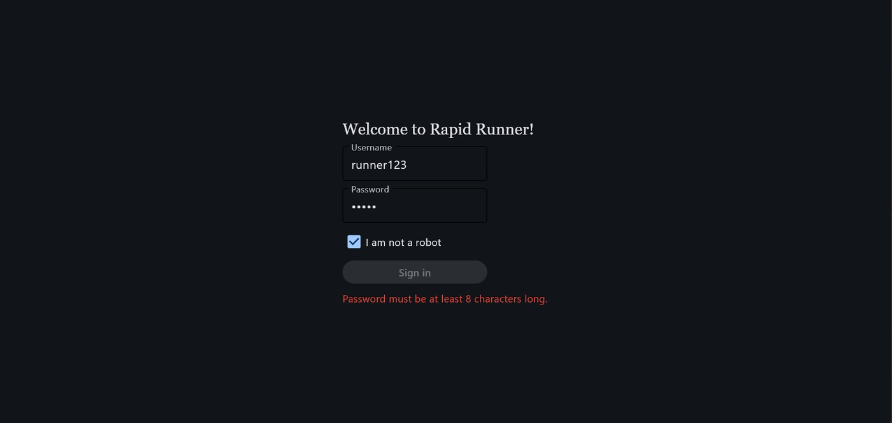
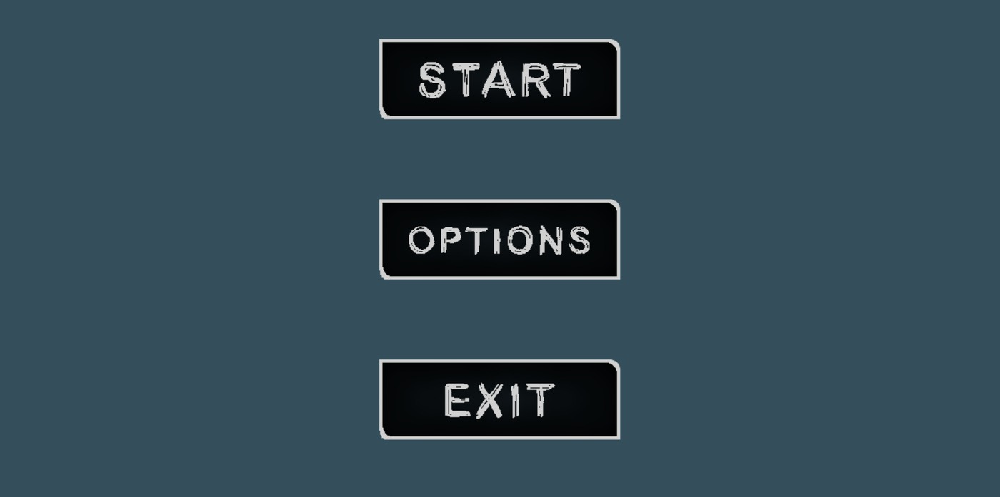
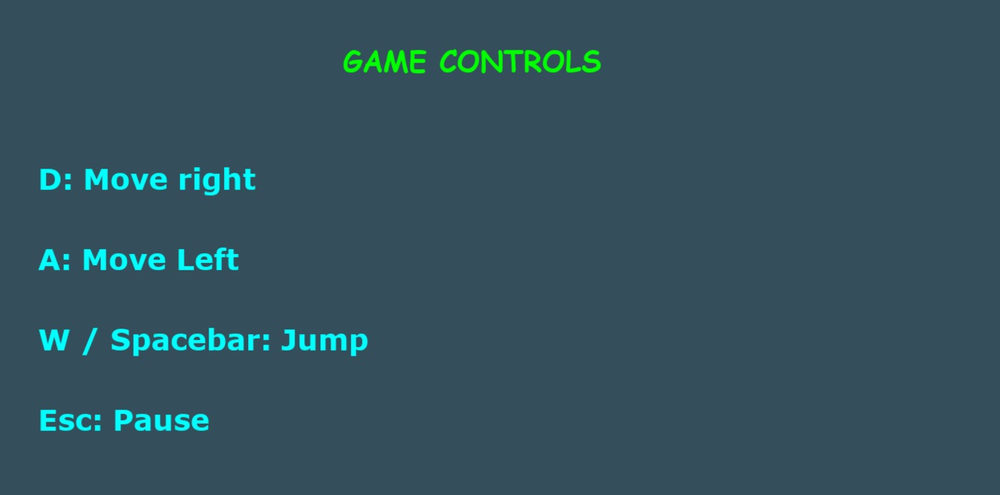
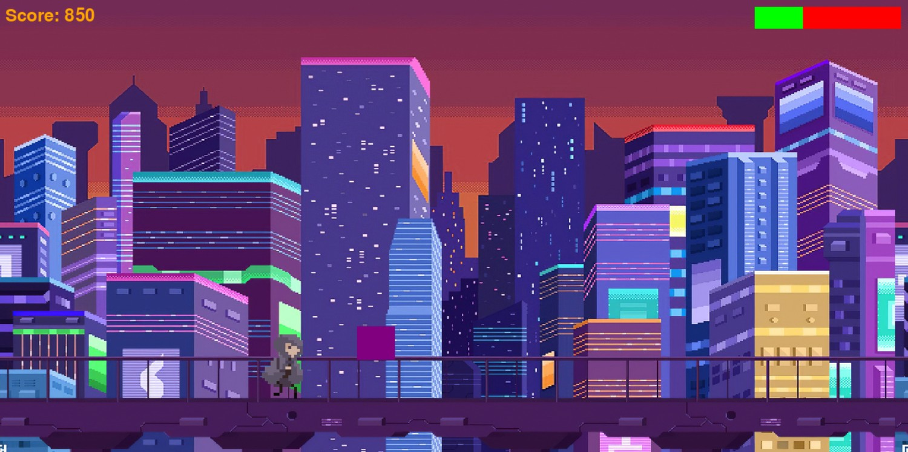

# Rapid Runner

Rapid Runner is an endless-runner game I built in Python as an individual coursework project, developed from November 2024 to April 2025.

The program combines a Flet sign-in screen, a Pygame menu system and the main endless-runner game. I programmed each part myself and used the project to learn how a larger Python program can be split across multiple files and classes while still working as one application.

**Python · Pygame · Flet**

## Screenshots

<p align="center">
  
  
</p>

<p align="center">
  
  
</p>

The sign-in screen uses input validation before allowing the player to continue. From the main menu, the player can start the game, open the options menu or exit. The options menu includes a music button that increases the volume, an information button that displays the controls, and a return button that goes back to the main menu.

The gameplay screen combines the player animation, scrolling city background, randomly generated obstacles, score and health bar.

## Main features

- Flet sign-in screen with username and password validation
- Main menu with Start, Options and Exit
- Controls/information screen
- Running and jumping sprite animations
- Left and right player movement
- Endless scrolling background
- Random obstacle generation
- Collision detection and health system
- Score tracking
- Background music and menu volume control

## How it works

The project is split into several Python files rather than being written as one large script.

`Executing_File.py` controls the main menu and links the different parts of the program together. `Validation3.py` contains the Flet sign-in interface. `Animation7.py` contains the main game loop, player animation, movement, background scrolling, scoring and collision behaviour.

The smaller classes handle individual parts of the game, including reusable menu buttons, obstacles and the health bar.

## The main challenge

The animation section was the most difficult part of the project.

There was not one individual feature that caused the most difficulty. The main challenge was combining several classes, files and game systems without causing errors elsewhere in the program. Player animation, movement, obstacles, collisions, health, score, background scrolling and the menu all had to work together as one program.

Working through those integration problems gave me much more practical experience with debugging larger programs.

## What I learned

This project was where I gained most of my early practical experience with Pygame and Flet. It also helped me become more comfortable with:

- game loops and Pygame events
- sprite animation
- classes and objects
- working across multiple Python files
- collision detection
- user input
- timing and score updates
- building a simple interface with Flet
- debugging interactions between different parts of a program

## Running the project

The original project was built using an older Flet API. To run the original sign-in code, Flet 0.24.1 can be used alongside Pygame:

```bash
python -m venv .venv
```

Activate the virtual environment, then install:

```bash
python -m pip install pygame
python -m pip install "flet==0.24.1"
```

Run the application with:

```bash
python Executing_File.py
```

The original code also expects soundtrack files inside a `Soundtracks/` folder. Those audio files are not included in this public repository because I do not have clear licensing information for them, so suitable local or replacement audio files are required for the original execution path.

## Project structure

```text
Executing_File.py        Main menu and application entry point
Validation3.py           Flet sign-in screen
Animation7.py            Main game loop and player animation
Buttons_Class.py         Reusable menu button class
Obstacles_Class.py       Obstacle sprite class
HealthBar.py             Health bar
Buttons/                 Menu button images
Run_Animation/           Running animation frames
Jump_Animation/          Jumping animation frames
Game_Backgrounds/        Game background
screenshots/             Screenshots used in this README
```

## Current limitations

This repository keeps the original coursework implementation, including some decisions I would change now.

The sign-in prototype prints the entered username and password and writes them to `name_password.txt` in plain text. It should not be used with real credentials.

There are also areas I would improve in the game loop, particularly the pause/restart behaviour and obstacle spawning.

## What I would improve next

- remove plaintext password storage
- replace or remove the prototype sign-in approach
- improve pause and restart behaviour
- improve obstacle spawning
- use clearly licensed replacement audio
- add tests for non-graphical game logic
